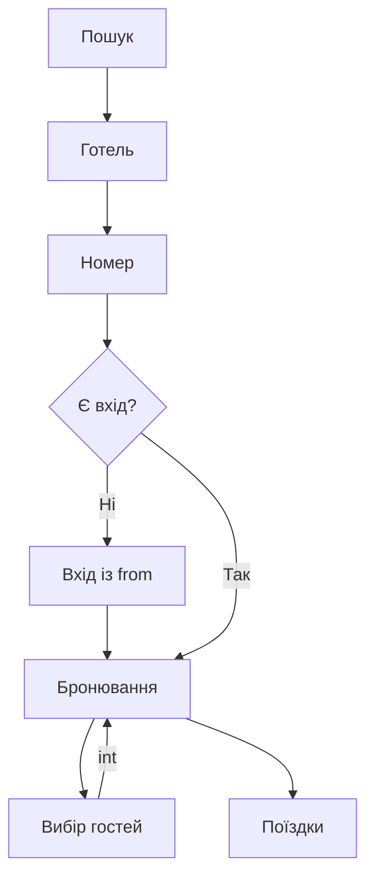

# Практична робота 7 — Роутинг і навігація в Flutter

**Варіант 5: Бронювання житла**  
Дисципліна: Програмування для мобільних платформ.

## Мета

Побудувати дерево маршрутів із параметрами, захистити бронювання входом, зберігати стан вкладок та повертати дані між екранами через go_router 17.x.

## Що реалізовано

- Три вкладки: «Пошук», «Поїздки», «Обране» на `StatefulShellRoute.indexedStack`.
- Чотири тестові готелі у Львові, Києві та Одесі, по два типи номерів.
- Пошук за містом і кількістю ночей (1–30); ці параметри записуються в URL.
- Сторінки готелю й номера, обране, розрахунок вартості за кількістю ночей.
- Демонстраційний вхід; `redirect` і `refreshListenable` повертають на повну початкову адресу.
- Вибір гостей через `context.push<int>()` → `context.pop<int>(n)`.
- Форма з коментарем та `PopScope`; вихід із незбереженими змінами потребує підтвердження.
- `onExit` додатково захищає форму від програмної зміни маршруту. Бронювання відкривається над нижньою панеллю.
- «Поїздки»: `TabBar` «Майбутні / Минулі». Нове бронювання потрапляє до майбутніх; минулі початково порожні.
- Обробка невідомого URL через `errorBuilder`, невідомого готелю/номера — окремим повідомленням.
- Android та iOS налаштовані на `trip://app/hotels/1?nights=3`.

Усі дані зберігаються в пам'яті одного демонстраційного сеансу. Після перезапуску вони скидаються. Вхід не є справжньою автентифікацією; мережі, бази, оплати й реального бронювання немає. Вихід із демоакаунта не очищує його локальні записи.

## Стан перевірки

Підготовлено код, 7 автоматичних тестів та workflow GitHub Actions. Статично перевірено локальні імпорти, XML/Info.plist, налаштування схеми, історію Git та архів. **Flutter analyze, flutter test, збірку та запуск на пристрої тут не виконано.** Попередній запуск Flutter у цьому середовищі був відхилений автоматичною перевіркою через можливе звернення до cloud metadata endpoint. Обхід блокування не застосовувався.

Скриншоти та результати виконання не вигадані: їх потрібно додати після запуску. Наявність тестів не означає, що вони вже пройшли. Репозиторій ще не опублікований на GitHub.

## Запуск

Потрібні Flutter stable з Dart >=3.9, Android SDK/емулятор або macOS із Xcode для iOS. CI використовує Flutter 3.35.5; залежність `go_router: ^17.0.0` обмежена гілкою 17.x.

```bash
flutter doctor
flutter pub get
flutter analyze
flutter test
flutter run
```

Після `flutter pub get` додайте створений `pubspec.lock` у Git для відтворюваності версій. Каталоги Android, iOS і Web включено; `build/` та `.dart_tool/` виключено. Web можна перевірити через `flutter run -d chrome` або `flutter build web`.

## Карта маршрутів

| Шлях | Екран | Захист / призначення |
|---|---|---|
| `/hotels?city=Львів&nights=3` | Пошук | Фільтр міста і кількість ночей |
| `/hotels/:hotelId?city=...&nights=...` | Готель | Пошук даних за ID без `extra` |
| `/hotels/:hotelId/rooms/:roomId?city=...&nights=...` | Номер | Ціна та місткість |
| `/hotels/:hotelId/book?city=...&nights=...&room=family` | Бронювання | Лише після входу; root Navigator |
| `/hotels/:hotelId/book/guests?city=...&nights=...&room=family` | Вибір гостей | Повертає int; захищений |
| `/trips` | Поїздки | Майбутні / Минулі |
| `/favorites` | Обране | Збережені готелі |
| `/login?from=...` | Вхід | Повернення на повний URI |
| Невідомий шлях | Помилка | Кнопка повернення до пошуку |

## Архітектура і навігація

`lib/main.dart` володіє `TripState` і GoRouter та звільняє їх у `dispose()`. Конфігурація маршрутів міститься в `lib/router.dart`, моделі — `lib/models/`, стан і guard — `lib/state/`, екрани — `lib/screens/`.

Вкладки мають окремі навігаційні стеки. `shell.goBranch(i)` повертає збережений стек без примусового скидання до кореня. При `context.go('/hotels/1/rooms/standard?...')` вкладений маршрут формує стек «Пошук → Готель → Номер». Deep link до готелю формує «Пошук → Готель», тому «Назад» повертає до пошуку. Параметри `city` і `nights` передаються функцією `location()` на кожному кроці, а не лише зберігаються локально.



## Захист маршруту

`tripRedirect()` зберігає `state.uri.toString()` у query-параметрі `from`. Після `store.login()` викликається `notifyListeners()`, `refreshListenable` повторно запускає guard та повертає користувача на цю адресу разом із містом, ночами й номером. `Uri` коректно кодує вкладені параметри та кирилицю. `safeReturn()` забороняє зовнішні адреси й дозволяє лише локальні шляхи каталогу.

Наприклад, `/hotels/1/book?city=Львів&nights=3&room=family` після входу лишається тією самою адресою за змістом параметрів.

## Повернення результату і захист форми

`BookingScreen._chooseGuests()` очікує `context.push<int>(...)`. `GuestsScreen` повертає число через `context.pop<int>(n)`. Кількість варіантів обмежена місткістю номера. Після `await` перевіряється `mounted`; скасування вибору повертає `null` і зберігає попередню кількість.

Коментар і змінена кількість гостей роблять форму незбереженою. `PopScope` блокує повернення, показує діалог і дозволяє вихід лише після підтвердження. `onExit` застосовує ту саму перевірку при `go` або новому deep link. Після успішного бронювання вихід дозволяється без діалогу. Контролер коментаря та контролер міста звільняються в `dispose()`.

Прямого `Navigator.push` немає. `Navigator.pop` використовується тільки для закриття діалогу, що дозволено умовами.

## Перевірка deep link

Android: запустіть застосунок хоча б один раз на емуляторі або пристрої.

```bash
adb shell am start -W -a android.intent.action.VIEW -c android.intent.category.BROWSABLE -d 'trip://app/hotels/1?nights=3' ua.edu.iot.trip_routing7
adb shell am start -W -a android.intent.action.VIEW -c android.intent.category.BROWSABLE -d 'trip://app/hotels/1/book?city=Lviv&nights=3&room=family' ua.edu.iot.trip_routing7
```

iOS Simulator після встановлення застосунку:

```bash
xcrun simctl openurl booted 'trip://app/hotels/1?nights=3'
xcrun simctl openurl booted 'trip://app/hotels/1/book?nights=3&room=family'
```

Android: `android/app/src/main/AndroidManifest.xml`, intent filter `VIEW`, `DEFAULT`, `BROWSABLE`, scheme `trip`, host `app`. iOS: `ios/Runner/Info.plist`, `CFBundleURLSchemes` = `trip`, `FlutterDeepLinkingEnabled` = true. Налаштування custom scheme не потребує власного домену. Перевірте холодний запуск і відкриття посилання у вже запущеному застосунку.

## Сценарії демонстрації

| Кроки | Очікуваний результат | Фактичний результат |
|---|---|---|
| Львів, 3 ночі → готель → номер → бронювання без входу → увійти | Форма з тими самими city, nights, room | Заповнити після запуску |
| Відкрити готель → Обране → Пошук | Той самий готель, а не корінь списку | Заповнити |
| Відкрити `trip://app/hotels/1?nights=3` | Готель; текст «Ночей: 3» | Заповнити |
| Вибрати 2 гостей | На формі «Гостей: 2» | Заповнити |
| Змінити коментар → Назад → Залишитися | Текст не втрачено | Заповнити |
| Назад → Відкинути | Форма закривається | Заповнити |
| Підтвердити бронювання | Запис у майбутніх поїздках | Заповнити |
| `/unknown`, `/hotels/999` | Зрозуміла помилка | Заповнити |
| Місто без готелів | Порожній стан | Заповнити |

Тести: `test/booking_test.dart` — 5 перевірок guard, параметрів, валідації та обраного; `test/navigation_test.dart` — 2 перевірки збереження вкладки та повернення гостей/діалогу виходу. Workflow `.github/workflows/flutter.yml` має запускати analyze, test і web build після push; результат перевірте у GitHub Actions.

## Труднощі та рішення

1. Втрата query після входу — збережено повний URI у `from`.
2. Втрата екрана при перемиканні вкладок — окремі стеки StatefulShellRoute.
3. Бронювання з некоректним ID — явний пошук готелю/номера й перевірка у моделі.
4. Подвійне натискання вибору гостей/збереження — локальні прапорці блокують повторний перехід.
5. Вихід через різні джерела навігації — спільна перевірка для PopScope та onExit.
6. Недоступний запуск Flutter у середовищі підготовки — додано тести, CI та чесний список неперевірених результатів.

## Здача на GitHub

Архів містить історію Git із щонайменше 5 осмисленими комітами. Розпакуйте його зі збереженням `.git`, створіть порожній репозиторій GitHub без автоматичного README та виконайте:

```bash
git log --oneline
# Замініть URL власною адресою репозиторію.
git remote add origin https://github.com/YOUR_LOGIN/trip-routing7.git
git push -u origin main
```

Після локальної перевірки додайте реальні скриншоти з `docs/README.md`, `pubspec.lock` і фактичні результати:

```bash
git add README.md docs pubspec.lock
git commit -m "Document verified runs and navigation screenshots"
git push
```

У Classroom здайте **посилання на GitHub-репозиторій**, не ZIP. Не позначайте analyze чи тести успішними до їх фактичного виконання.

## Висновок

Підготовлено навчальну реалізацію навігації для бронювання житла: параметризовані маршрути, захищена форма, незалежні вкладки, повернення значення та custom deep link. Перед остаточною здачею необхідно виконати runtime-перевірки й додати власні докази запуску.

## Джерела

Дата звернення: 30.10.2026.

- [go_router 17.0.0](https://pub.dev/packages/go_router/versions/17.0.0)
- [StatefulShellRoute](https://pub.dev/documentation/go_router/latest/go_router/StatefulShellRoute-class.html)
- [Redirection](https://pub.dev/documentation/go_router/latest/topics/Redirection-topic.html)
- [PopScope](https://api.flutter.dev/flutter/widgets/PopScope-class.html)
- [Deep linking](https://docs.flutter.dev/ui/navigation/deep-linking)

Посилання latest можуть описувати новішу версію; у проєкті встановлено обмеження go_router 17.x.
